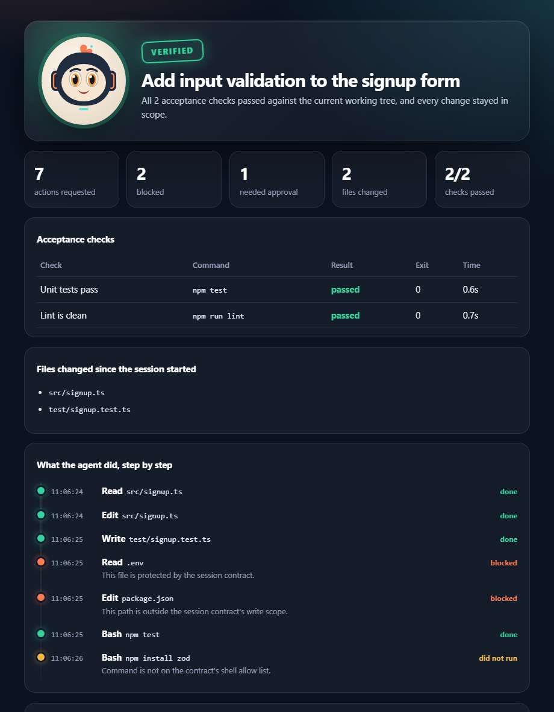

# Work Receipts for Claude Code

By Enock Labs.

**Know what your agent actually did, not what it says it did.**

Work Receipts is a Claude Code plugin. You write a short contract: the goal, which files may change, which commands are pre-approved, and which checks prove the work is done. The plugin enforces that scope on every tool call, records everything in a tamper-evident log, and ends the session with a receipt whose verdict comes from real checks and git, never from the model.



## Why

Agents report success. Reviewers need proof. A Work Receipt answers four questions in one shareable file:

1. **Did the checks pass?** Your acceptance commands are run and their results recorded.
2. **Did the agent stay in scope?** File writes outside scope are blocked as they happen, and git independently confirms that nothing else changed. That includes changes made through shell commands.
3. **What exactly happened?** A step-by-step timeline shows every tool call, including subagents, and whether it ran, needed approval, or was blocked and why.
4. **Can I trust this file?** The HTML receipt embeds its full evidence. Anyone can re-verify it, and edits are detected.

## Install

Requirements: Claude Code, Node.js 20 or newer (22+ recommended for faster hooks), and git. Each hook adds about 20 ms on top of Node start-up.

From a clone of this repository, inside Claude Code:

```text
/plugin marketplace add ./
/plugin install work-receipts@enock-labs
```

Or try it for one session: `claude --plugin-dir ./plugin`.

## Quick start

1. `/receipt-init` creates `receipts.contract.json`. Edit it yourself; the agent is blocked from changing it.

   ```json
   {
     "schemaVersion": "1.0",
     "goal": "Add input validation to the signup form without touching the build setup",
     "write": ["src/**", "test/**"],
     "shell": { "allow": ["npm test", "npm run lint"], "otherwise": "ask" },
     "checks": [
       { "id": "tests", "description": "Unit tests pass", "command": "npm test" },
       { "id": "lint", "description": "Lint is clean", "command": "npm run lint" }
     ]
   }
   ```

2. Start a session and work normally. At session start Claude is told its scope, so it does not waste turns on actions that will be blocked.
3. `/receipt` runs the checks and writes `.receipts/sessions/<session>/receipt.html`, plus `receipt.md` and `receipt.json`.
4. Run `/receipt-pr` for a ready-to-paste pull request summary (verdict, checks, scope), and attach `receipt.html` to the PR or send it to a client. Receipts are signed with a key that is created on first use in `~/.work-receipts/`, outside every project and blocked from the agent. Run `node plugin/bin/cli.js key` to see your fingerprint, and publish it. Anyone can check a receipt:

   ```bash
   node plugin/bin/cli.js verify receipt.html --expect-key <your fingerprint>
   ```

## Verdicts

| Verdict | Meaning |
| --- | --- |
| **Verified** | The log is intact, every changed file is in scope, and every check passed. |
| **Out of scope** | Git shows a file outside the write scope changed, by any means. |
| **Checks failed** | At least one acceptance check failed or timed out. |
| **Unverified** | No contract, no checks, no git evidence, or a root-level executable changed that could fake a check. |
| **Log integrity failure** | A recorded event was edited after it was written. |

Changes to files that define what the checks run (package.json, lockfiles, test configs) are flagged for human review on every receipt.

## Proven under attack

An adversarial benchmark replays 24 scripted sessions against the shipped plugin, assuming the worst case that every approval prompt is clicked through. Current result: **18/18 scope attacks stopped** (13 prevented before running, the rest caught by the receipt), **0** relying only on a human, and **3/3** legitimate sessions verified with zero interruptions. One known gap is kept in the suite on purpose. Full results: [docs/BENCHMARK.md](docs/BENCHMARK.md). Re-run with `npm run bench`.

## What is enforced

- **Writes** through Write, Edit, MultiEdit and NotebookEdit must match `write` and must not match `protect`. Writes outside the project are denied. Junctions and symlinks are resolved, and Windows alias forms (trailing dots, alternate data streams, 8.3 names, device paths) are denied.
- **Protected files** (`.env`, keys, certificates by default) cannot be read or written by file tools.
- **Shell commands** run without a prompt only if they exactly match `shell.allow` and contain no chaining, substitution, grouping, quoting or wildcard characters. Everything else follows `shell.otherwise` (`ask` by default). Commands that name a protected file, download and execute code, evaluate strings as code, or wipe the root or home directory are always denied.
- **The recorder's own files** (`.receipts/` and the contract) can never be modified by the agent, with or without a contract.
- **Unknown tools** need approval while a contract is active.
- The plugin only ever **blocks or asks**. It never grants a permission your Claude Code settings would not.

Without a contract the plugin records only, and blocks nothing except changes to its own files.

## Privacy

Everything stays on your machine. The plugin makes no network requests. Logs store project-relative paths, redacted command previews and digests, not file contents or tool output. URL query strings are dropped. Receipts contain no absolute paths or user names.

## What a receipt does not prove

Every receipt states these limits:

- A log deleted or regenerated wholesale by someone with access to the machine is not detected. The git comparison does not depend on the log.
- Git does not compare gitignored files, and it counts your own edits made during the session.
- An approval prompt followed by execution does not identify who approved it.
- Checks run when the receipt is generated, and a check is only as trustworthy as the test code behind it.
- Command redaction is heuristic.
- `verify` proves a receipt is internally consistent, unedited, and signed by a given key. It does not prove the recorded check results were truthful.
- The agent runs as your OS user. Key access through file tools or shell commands that name the key is blocked, but a disguised shell command you approve could still read it.

## Development

```bash
npm install
npm run check          # typecheck, tests, app build, plugin build
npm run build:plugin   # rebuild plugin/dist after changing src/recorder
```

Source lives in `src/recorder/`. The committed bundles in `plugin/dist/` are rebuilt by CI, and CI fails if they are stale.

## Licence

Source-available under the [PolyForm Noncommercial License 1.0.0](LICENSE). Personal and noncommercial use is free. Commercial use requires a commercial licence from Enock Labs.

Work Receipts is an independent product. It is not affiliated with, sponsored by, or endorsed by Anthropic. Claude and Claude Code are trademarks of Anthropic.
