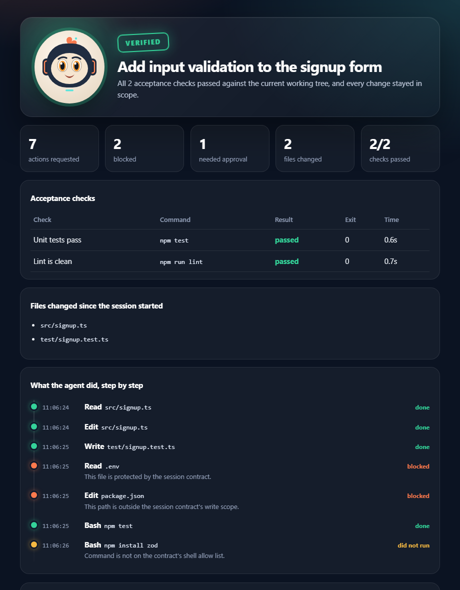

# Work Receipts for Claude Code

By Enock Labs.

**Know what your agent actually did, not what it says it did.**

Work Receipts is a Claude Code plugin. You write a short contract: the goal, which files may change, which commands are pre-approved, and which checks prove the work is done. The plugin enforces that scope on every tool call, records everything in a tamper-evident log, and ends the session with a receipt whose verdict comes from real checks and git, never from the model.



## Why

Agents report success. Reviewers need proof. A Work Receipt answers four questions in one shareable file:

1. **Did the checks pass?** Your acceptance commands are run and their results recorded.
2. **Did the agent stay in scope?** File writes outside scope are blocked as they happen, and git independently confirms that nothing else changed. That includes changes made through shell commands.
3. **What exactly happened?** A step-by-step timeline shows every tool call, including subagents, and whether it ran, needed approval, or was blocked and why.
4. **Can I trust this file?** The HTML receipt embeds its full evidence. Anyone can re-verify it, and edits are detected.

## Install

Requirements: Claude Code, Node.js 20 or newer (22+ recommended for faster hooks), and git. Each hook adds about 20 ms on top of Node start-up.

Inside Claude Code:

```text
/plugin marketplace add iamGodofall/work-receipts
/plugin install work-receipts@enock-labs
```

Or from a clone: `/plugin marketplace add ./`, or try it for one session with `claude --plugin-dir ./plugin`.

See it working: the [live gate demo](https://github.com/iamGodofall/work-receipts-demo/pulls?q=is%3Apr) has a pull request that passes with a verified receipt and one that fails because its code was edited after the receipt.

## Quick start

1. `/receipt-init` creates `receipts.contract.json` from your project's own files: it finds your test, lint, type-check, and build commands (npm, pnpm, yarn, bun, Python with pytest/ruff/mypy, Rust, Go, or a Makefile `test` target), pre-approves them, and limits writes to the source, test, and docs folders that exist. Root files such as `package.json` and CI config stay out of scope, so the agent cannot change what the checks run. If nothing is recognised, a placeholder check fails on purpose until you replace it. Set the goal and review the scope yourself; the agent is blocked from changing the file. `/receipt-validate` confirms it is valid and names the exact field to fix if not.

   ```json
   {
     "schemaVersion": "1.0",
     "goal": "Add input validation to the signup form without touching the build setup",
     "write": ["src/**", "test/**"],
     "shell": { "allow": ["npm test", "npm run lint"], "otherwise": "ask" },
     "checks": [
       { "id": "tests", "description": "Unit tests pass", "command": "npm test" },
       { "id": "lint", "description": "Lint is clean", "command": "npm run lint" }
     ]
   }
   ```

2. Start a session and work normally. At session start Claude is told its scope, so it does not waste turns on actions that will be blocked.
3. `/receipt` runs the checks and writes `.receipts/sessions/<session>/receipt.html`, plus `receipt.md` and `receipt.json`.
4. Run `/receipt-pr` for a ready-to-paste pull request summary (verdict, checks, scope), and attach `receipt.html` to the PR or send it to a client. Receipts are signed with a key that is created on first use in `~/.work-receipts/`, outside every project and blocked from the agent. Run `node plugin/bin/cli.js key` to see your fingerprint, and publish it. Anyone can check a receipt:

   ```bash
   node plugin/bin/cli.js verify receipt.html --expect-key <your fingerprint> --tree HEAD
   ```

   `--tree <commit>` confirms the commit contains exactly the code the checks ran against. Add `--require-verified` to fail on any other verdict.

## Bound to the exact code, gated in CI

Every receipt names the code its checks ran against by its git tree hash: the content `git add -A` would commit, excluding gitignored files and the `.receipts` folder. The hash is refused, and the receipt says why, when it would not name the bytes the checks read: `.gitattributes` rules that rewrite content (`ident`, `filter`, `working-tree-encoding`), a project that is a subfolder of its repository, or a submodule with uncommitted changes. Line-ending normalisation is accepted, because a commit applies it identically. If a check rewrites files while running (for example, a linter with `--fix`), the receipt is **Unverified**, because the code that passed is no longer the code that remains.

Because `.receipts` is excluded, a receipt can be committed inside the pull request it describes:

```bash
git add -A && git add -f .receipts/sessions/<session>/receipt.json && git commit
```

The [Work Receipts gate](../action.yml) then fails the pull request unless a receipt signed by a key you trust is consistent, verified, and covers exactly the head commit's code. It reads receipts from the commit's git objects, never from the working directory, and fails if `.receipts` holds anything other than receipt artifacts, since that folder is outside the receipted code. A single edit after the receipt was generated fails the gate. Copy [the example workflow](plugin/examples/work-receipts-gate.yml), or run the same check anywhere:

```bash
node plugin/bin/cli.js ci --expect-key <fingerprint>[,<fingerprint>] --tree <commit>
```

## Standard attestations

Signed receipts also write `receipt.intoto.json`: an [in-toto Statement v1](https://github.com/in-toto/attestation/blob/main/spec/v1/statement.md) in a [DSSE](https://github.com/secure-systems-lab/dsse/blob/master/protocol.md) envelope, signed with the same Ed25519 key. Its subject is the git tree (`gitTree` digest); its predicate carries the verdict, check results, scope findings, authorship counts, and the digest of the full evidence bundle. Other in-toto tooling can parse it, and the signature was checked independently with OpenSSL.

```bash
node plugin/bin/cli.js verify-attestation receipt.intoto.json --expect-key <fingerprint> --tree HEAD
```

## Authorship

Each receipt reports how many of the lines added during the session were written by agent file tools and how many came from elsewhere: shell commands, formatters, code generators, or a person. The hook keeps keyed digests of the lines the agent wrote (HMAC-SHA-256 with a per-session key derived from a secret in `~/.work-receipts/`, which the agent cannot read) in a private file next to the session log. The chained log records only a hash of each digest list, so that file cannot be padded, and the digests never enter a receipt. Receipts carry counts only. Generic lines such as `}` are excluded from both counts.

## Verdicts

| Verdict | Meaning |
| --- | --- |
| **Verified** | The log is intact, every changed file is in scope, and every check passed. |
| **Out of scope** | Git shows a file outside the write scope changed, by any means. |
| **Checks failed** | At least one acceptance check failed or timed out. |
| **Unverified** | No contract, no checks, no git evidence, a root-level executable changed that could fake a check, or a check changed files while running. |
| **Log integrity failure** | A recorded event was edited after it was written. |

Changes to files that define what the checks run (package.json, lockfiles, test configs) are flagged for human review on every receipt.

## Adversarial validation

The latest committed benchmark report records **22/22 scripted attack scenarios prevented or caught**, with 15 prevented before execution, **2/2** in-scope destructive actions routed for approval, **5/5** benign sessions verified without interruption, and zero scenarios listed in the report's known-gap section. The harness drives the shipped hook and CLI through fresh temporary Git repositories and assumes every approval prompt is accepted when measuring whether enforcement or later verification catches an attack.

These are results from a finite scripted regression suite, not a penetration test, a live-session coverage guarantee, or an external security certification. The report lists each tested scenario and outcome in [docs/BENCHMARK.md](docs/BENCHMARK.md). Run `npm run bench` to reproduce the suite. CI reruns it on Ubuntu and uploads the commit-specific report as an artifact.

## What is enforced

- **Writes** through Write, Edit, MultiEdit and NotebookEdit must match `write` and must not match `protect`. Writes outside the project are denied. Junctions and symlinks are resolved, and Windows alias forms (trailing dots, alternate data streams, 8.3 names, device paths) are denied.
- **Protected files** (`.env`, keys, certificates by default) are blocked on direct file-tool access and named shell commands. Directory content searches are checked against protected paths which the search would read. Keep credentials outside project search paths and apply operating-system access controls as an additional boundary.
- **Shell commands** run without a prompt only if they exactly match `shell.allow` and contain no chaining, substitution, grouping, quoting or wildcard characters. Everything else follows `shell.otherwise` (`ask` by default). Commands that name a protected file, download and execute code, evaluate strings as code, or wipe the root or home directory are always denied.
- **The recorder's own files** (`.receipts/` and the contract) can never be modified by the agent, with or without a contract.
- **Unknown tools** need approval while a contract is active.
- The plugin only ever **blocks or asks**. It never grants a permission your Claude Code settings would not.

Without a contract the plugin records only, and blocks nothing except changes to its own files.

## Privacy

Everything stays on your machine. The plugin makes no network requests. Logs store project-relative paths, redacted command previews and digests, not file contents or tool output. URL query strings are dropped. Receipts contain no absolute paths or user names.

## What a receipt does not prove

Every receipt states these limits:

- A log deleted or regenerated wholesale by someone with access to the machine is not detected. The git comparison does not depend on the log.
- Git does not compare gitignored files, and it counts your own edits made during the session.
- An approval prompt followed by execution does not identify who approved it.
- Checks run when the receipt is generated, and a check is only as trustworthy as the test code behind it.
- Command redaction is heuristic.
- `verify` proves a receipt is internally consistent, unedited, and signed by a given key. It does not prove the recorded check results were truthful.
- The agent runs as your OS user. Key access through file tools or shell commands that name the key is blocked, but a disguised shell command you approve could still read it.

## Development

```bash
npm install
npm run check          # typecheck, tests, app build, plugin build
npm run build:plugin   # rebuild plugin/dist after changing src/recorder
```

Source lives in `src/recorder/`. The committed bundles in `plugin/dist/` are rebuilt by CI, and CI fails if they are stale.

## Licence

Source-available under the [PolyForm Noncommercial License 1.0.0](LICENSE). Personal and noncommercial use is free. Commercial use requires a commercial licence from Enock Labs.

## Commercial licences and pilots

Teams using Claude Code can start with a fixed-scope, one-repository evaluation: Work Receipts configured on a representative repository with your own acceptance checks, permitted and blocked scenarios run, and a findings report with example receipts. For a commercial licence or an evaluation, email **landinwest@gmail.com**. Security issues: see [SECURITY.md](../SECURITY.md).

Work Receipts is an independent product. It is not affiliated with, sponsored by, or endorsed by Anthropic. Claude and Claude Code are trademarks of Anthropic.
